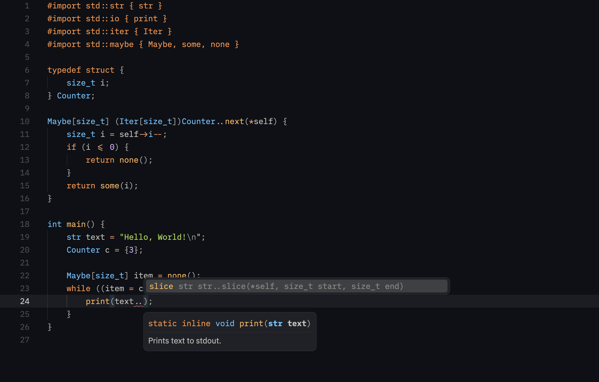

# aC(t)

aC is a superset of C. It has a few additional features a modern programming language bears.



It is currently impossible to compile aC code unless you have a working transpiler, which is not available publicly. But feel free to reach me out if you'd like to try it out yourself.

## Naming
The name "aC" doesn't really need to have any meaning. But originally, it was because I want a language that can transpile to C and ensures that my program gets accepted \([AC](https://zerojudge.tw/)\) no matter what. Interestingly, as you can see, the language itself has steered to a direction which makes it a bit complicated and "lower-level than expected" in a sense.

## Design
aC has a few features worth noting. First, it adds a few features from Rust, like [Drop](https://doc.rust-lang.org/std/ops/trait.Drop.html). Most of the time in C, it's considered "best practice" to put things into an arena allocator, for fear that one might forget to free allocated memory leading to inevitable memory leaks. But I don't buy that. It's definitely one of: a) you're not paying attention to your code at all; b) you hate reading your code; or c) you're lazy. In this case, I'm more of a c) person (pun intended), so why not build a program that tells you "hey, remember to free this sh\*t." I think that makes perfect sense.

Suppose you have some resource, and you always forget to free it. Usually, that's something like a buffer or a file. But to keep things simple, we'll just print stuff instead.

```c
#import std::io { print }

typedef struct {
    int number;
} Resource;

void free_resource(Resource *resource) {
    print("i freed it!\n");
}

int main() {
    Resource res = {69};
    print("doing stuff\n");
    return 0;
}
```

You can tell that our guy forgot to free the resource, but aC can fix that for us. By implementing `..drop()`, the resource is guaranteed to run upon exit:

```c
void Resource..drop(*self) {
    free_resource(self);
}
```

In the above example, the output C would be like so:

<details>
    <summary>Expand output</summary>

```c
/* generated by aC prototype v0.9 - do not edit */
/* ---- module panic ---- */
#include <stdio.h>
#include <stdlib.h>


/* ---- module maybe ---- */
#include <stdbool.h>


/* ---- module str ---- */
#include <stddef.h>
#include <string.h>

typedef struct { size_t len ; const char * ptr ; } ac__str ;

ac__str ac__std_str__str_from_cstr(const char * cstr);
ac__str ac__str__slice(ac__str * self , size_t start , size_t end);
ac__str ac__std_str__str_from_cstr(const char * cstr) { size_t len = strlen ( cstr ); ac__str ac__ret0 = { . len = len , . ptr = cstr }; return ac__ret0; }
ac__str ac__str__slice(ac__str * self , size_t start , size_t end) { if ( end > self -> len ) { end = self -> len ; } if ( start > end ) { start = end ; } ac__str ac__ret0 = ( ac__str ) { . len = end - start , . ptr = self -> ptr + start }; return ac__ret0; }

/* ---- module stdout ---- */
#include <stdio.h>


static inline void ac__std_io_stdout__print(ac__str text);
static inline void ac__std_io_stdout__println(ac__str text);
static inline void ac__std_io_stdout__print(ac__str text) { fwrite ( text . ptr , sizeof ( * text . ptr ) , text . len , stdout ) ; }
static inline void ac__std_io_stdout__println(ac__str text) { fwrite ( text . ptr , sizeof ( * text . ptr ) , text . len , stdout ) ; fputc ( '\n' , stdout ) ; }

/* ---- module result ---- */
#include <stdbool.h>


/* ---- module result ---- */


/* ---- module io ---- */


/* ---- module main ---- */

typedef struct { int number ; } ac__Resource ;

void ac__Resource__drop(ac__Resource *self);
void ac__Resource__drop_body(ac__Resource *self);
int main();
void ac__free_resource(ac__Resource * resource);
void ac__Resource__drop_body(ac__Resource * self) { ac__free_resource ( self ) ; }
int main() { ac__Resource res = { 69 }; ac__std_io_stdout__print ( ((ac__str){ sizeof("doing stuff\n") - 1, "doing stuff\n" }) ) ; int ac__ret0 = 0; ac__Resource__drop(&res); return ac__ret0; }
void ac__free_resource(ac__Resource * resource) { ac__std_io_stdout__print ( ((ac__str){ sizeof("i freed it!\n") - 1, "i freed it!\n" }) ) ; }
void ac__Resource__drop(ac__Resource *self) {
    ac__Resource__drop_body(self);
}


```

</details>

If you look closer and format everything, you'll see (C) that aC drops the resource for you at the end of the function scope.

```c
int main() {
    ac__Resource res = {69};
    ac__std_io_stdout__print(
        ((ac__str){sizeof("doing stuff\n") - 1, "doing stuff\n"}));
    int ac__ret0 = 0;
    ac__Resource__drop(&res);
    return ac__ret0;
}
```

This is what this language is about, generally.
